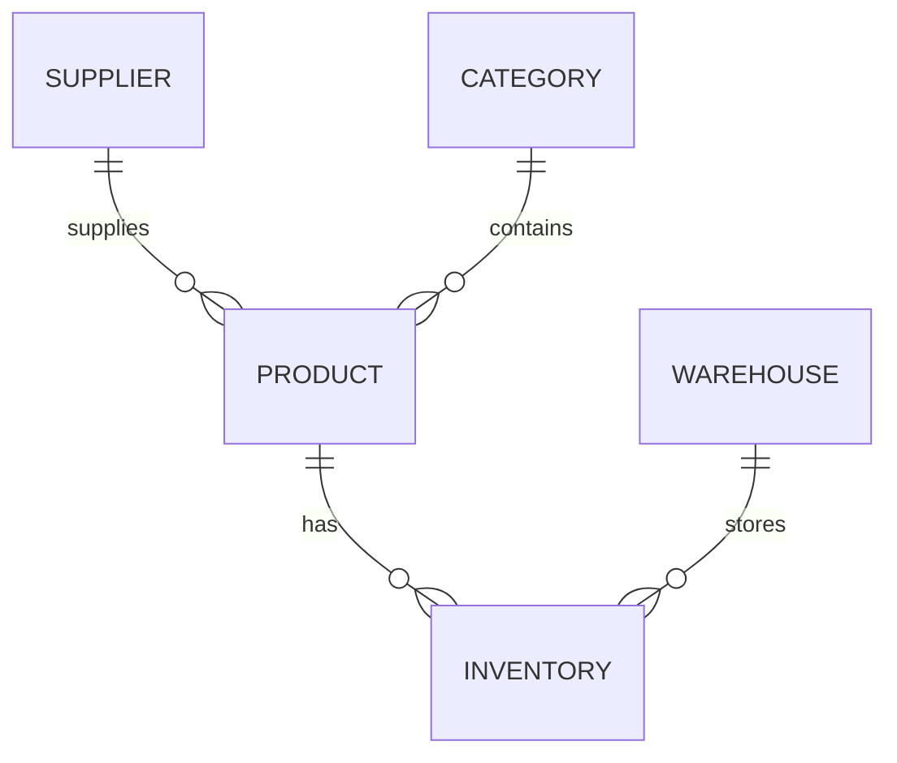

# Set 1 – Retail Inventory ER Diagram

## 3NF explanation
- **1NF:** Each cell contains one value.
- **2NF:** Product, supplier, category and warehouse details are separated from stock quantities.
- **3NF:** Supplier phone depends on supplier ID, category name depends on category ID, and warehouse name depends on warehouse ID. These details are stored in their own tables.

## Anomalies in the original spreadsheet
- **Insert:** A supplier cannot be added easily until a product is entered.
- **Update:** A supplier phone number may need to be changed in many rows.
- **Delete:** Removing the only product from a supplier may also remove that supplier's details.

`Inventory` has a unique `(sku, warehouse_id)` pair, so a product can be stored in many warehouses without duplicate stock rows for the same warehouse.
