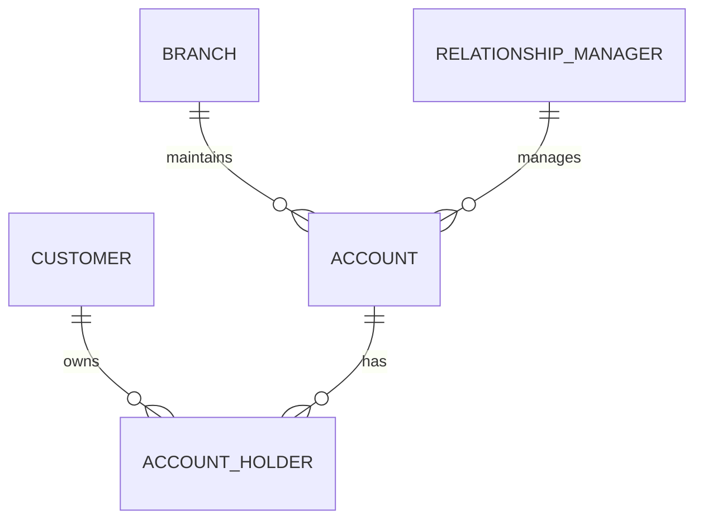

# Set 2 – Bank Branch Accounts ER Diagram

## Normalisation and keys
- Customer details are stored in `Customer`.
- Branch details are stored in `Branch`.
- Manager details are stored in `RelationshipManager`.
- Account details are stored in `Account`, with foreign keys for branch and manager.
- `AccountHolder` connects customers and accounts and supports joint accounts.

**Candidate keys:** customer ID/email, branch ID/branch code, manager ID/employee code, and account ID/account number can each uniquely identify a row in their respective tables.

**Composite key:** `(account_id, customer_id)` in `AccountHolder`. Both columns together identify one account-holder relationship.

## Data type choices
- `INT` for numeric IDs.
- `VARCHAR` for names, addresses and account numbers. Account numbers are text because they may contain letters or leading zeroes.
- `DECIMAL(12,2)` for balances because it stores exact decimal money values to two places.
- `DATE` for the account opening date.
- `AUTO_INCREMENT` creates numeric IDs automatically.
