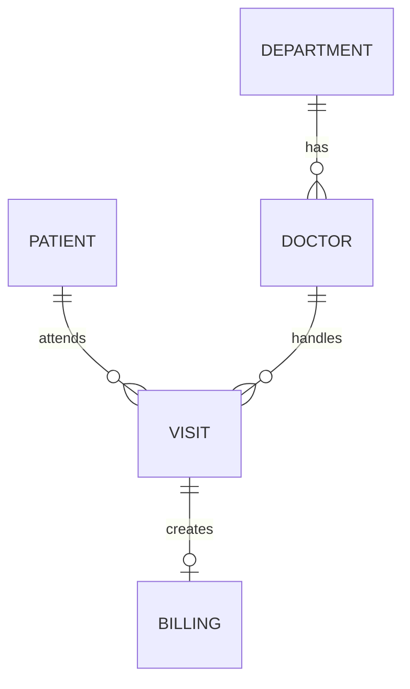

# Set 3 – Hospital Patient Records ER Diagram

## Normalisation to 3NF
- `Patient` stores each patient's name and address once.
- `Department` stores each department name once.
- `Doctor` stores the doctor and their department.
- `Visit` stores the patient, doctor, date, diagnosis, prescription and visit status.
- `Billing` stores the bill amount separately and connects it to a visit.

This reduces repeated patient, doctor and department information in the original wide spreadsheet.

## SQL and NoSQL comparison

| Point | SQL | NoSQL |
|---|---|---|
| Structure | Tables with rows and columns | Documents, key-value pairs or other formats |
| Consistency | Supports transactions and strong consistency | Depends on the database; consistency options vary |
| Scalability | Often scales vertically; horizontal options also exist | Often designed for horizontal scaling |
| Typical use | Banking, hospital records, inventory | Flexible large datasets, content and event data |

**Examples:** MySQL is SQL; MongoDB is a document-based NoSQL database.
